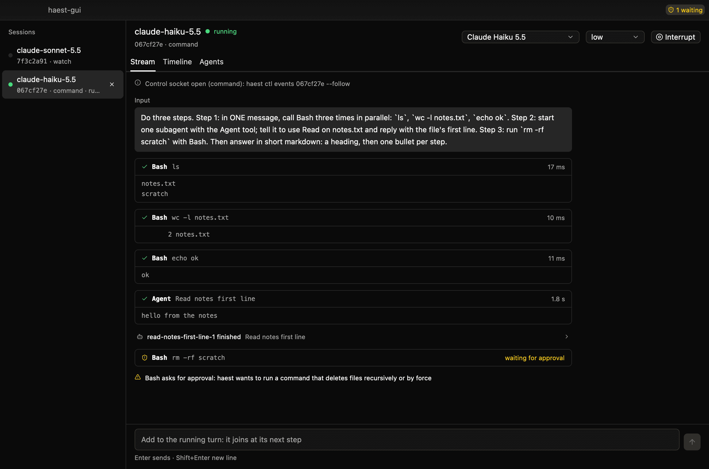
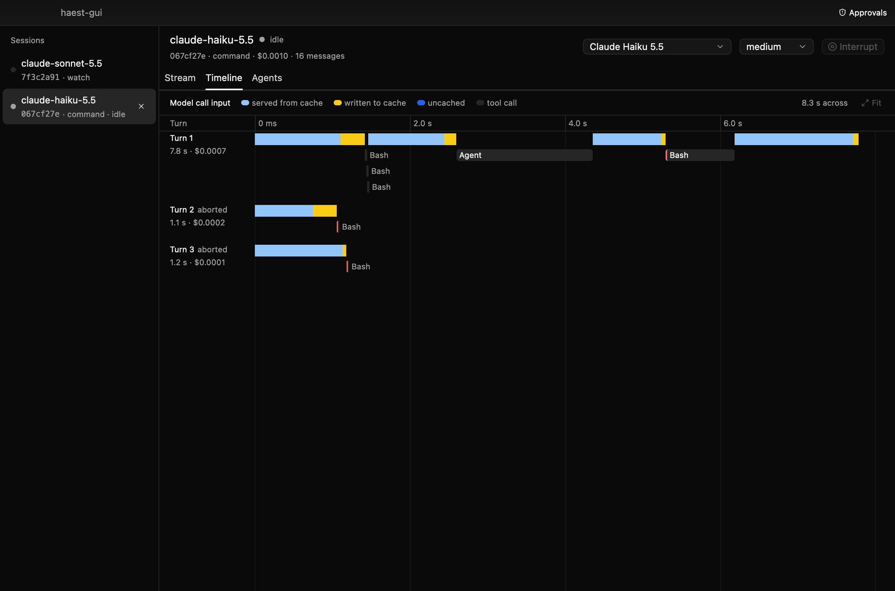
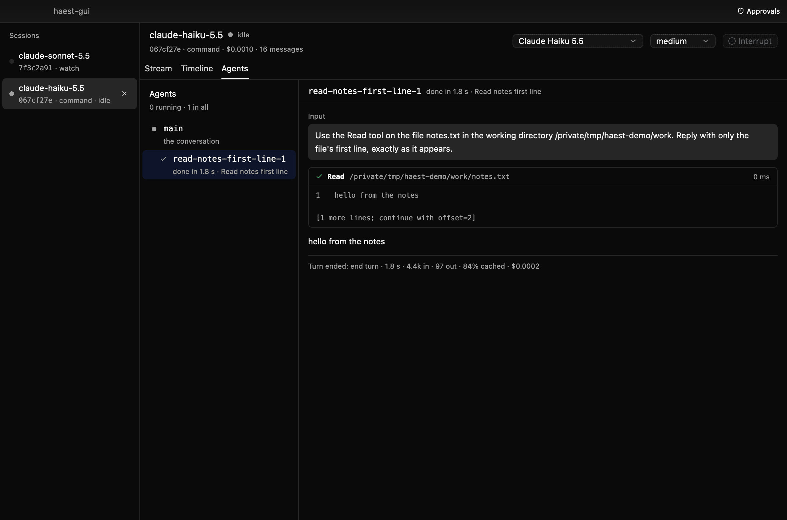
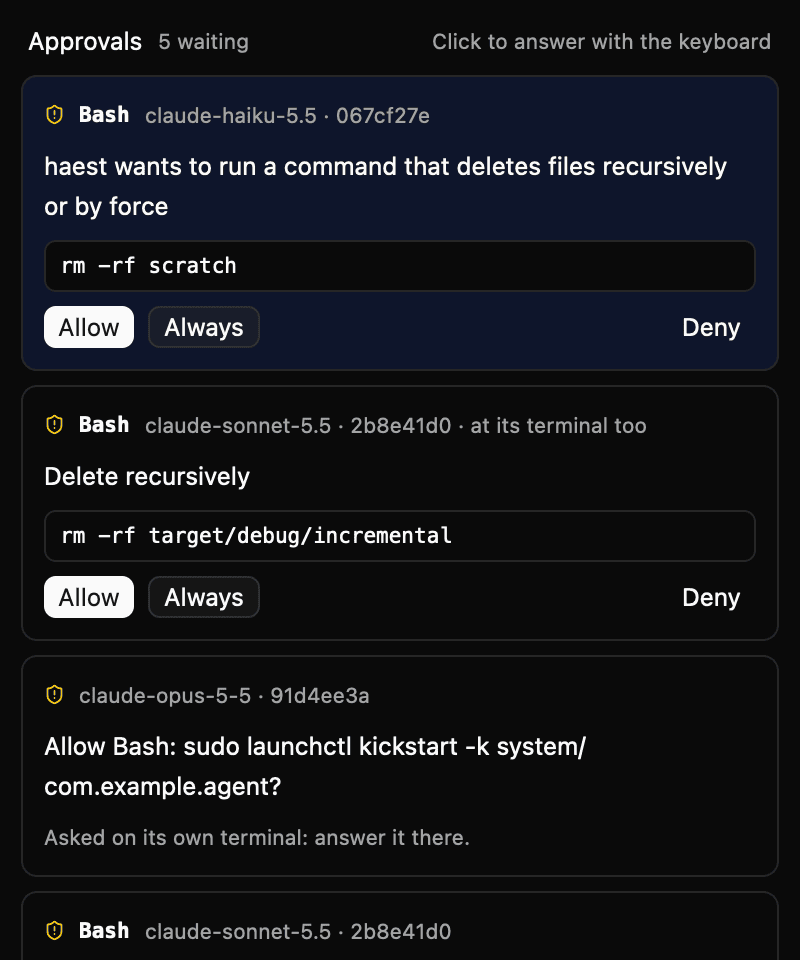

# haest-gui

**Experimental.** A native desktop window onto the haest sessions running on
this machine, built with [GPUI](https://www.gpui.rs) and gpui-component. A
graphical `haest ctl`: it finds every haest that runs with its control socket
on, and for the one you pick shows:

- **Stream**: the conversation as it happens. Answers as markdown, thinking as
  a dim lane you can fold, each tool call as a card (name, input, status,
  result, time). On a `command` socket: a composer, the model and effort
  pickers, and Interrupt (Cmd+.).
- **Timeline**: each turn as a track, model calls and tool calls as bars sized
  by how long they took, the calls of one batch stacked, and each model call
  split by what the prompt cache served, wrote and missed. Pinch or Cmd+scroll
  zooms, drag or a sideways scroll pans, Fit shows it all.
- **Agents**: the tree of subagents as they start and stop; click one to read
  its own stream.
- **Approvals**: a small always-on-top panel with the approval asks of every
  attached haest in one queue. Up/Down picks, Enter allows, Cmd+Enter allows
  always, Delete denies. It opens by itself when an ask arrives, without taking
  focus (so an Enter typed elsewhere never approves anything); Cmd+Shift+A or
  the title bar button brings it forward.









## Where it runs

Tested on macOS only (Apple silicon). It needs Rust 1.88+ and the Xcode
Command Line Tools (`xcode-select --install`), not Xcode: GPUI's Metal
shaders compile when the app starts (`runtime_shaders`), so the build never
calls the Metal compiler, which Xcode no longer ships by default.

- **Linux** is not supported yet. GPUI runs there, but this crate does not
  turn on GPUI's `x11` or `wayland` feature and has never been built there.
- **Windows** is not supported: haest's control socket is a Unix socket, and
  the client for it builds on Unix only.

## How to run

You need a haest with its control socket on, and haest-gui beside it. The
socket is off unless you turn it on: `watch` lets haest-gui read the
conversation; `command` also lets it send input, interrupt, change the model
and effort, and answer approvals.

haest offers the model no tools unless a profile or the `tools` setting says
which, so a bare `haest` only talks: no tool cards, no subagents, no approval
asks. The commands below use the built-in `claude` profile, which turns on
the file, shell and web tools and subagents, in the real workspace.

### From crates.io

```sh
cargo install haest-cli haest-gui     # puts `haest` and `haest-gui` on your PATH
```

Then, in one terminal:

```sh
haest --profile claude --control-socket command   # or HAEST_CONTROL_SOCKET=command
```

and in another:

```sh
haest-gui
```

### From a checkout of haest

haest-gui is not a member of haest's workspace (GPUI stays out of every haest
build), so it is built through its own manifest. From the repository root:

```sh
cargo run --release --bin haest -- --profile claude --control-socket command  # one terminal
cargo run --release --manifest-path crates/haest-gui/Cargo.toml             # another
```

### What to know

- haest-gui watches the control dir `haest ctl` uses: haest's `control_dir`
  setting, else `<data_dir>/control`. Point it elsewhere with
  `--control-dir DIR`. `haest-gui --help` lists the flags.
- **Approvals**: a haest with a `command` socket asks each approval at its own
  terminal and in haest-gui at once. The first answer counts, and the other
  side stops asking. The approvals mod asks only in the real workspace, which
  the `claude` profile picks (without it: `-w real`). With a `watch` socket
  haest-gui shows the asks read-only and says to answer them at the terminal.
- **Input sent to a haest that sits at its own idle prompt waits** until
  someone presses Enter in that terminal (haest's own rule for input from
  another program). The composer's hint says so when it happens.

## Replay a recording

```sh
haest ctl events <id> --json > session.ndjson   # record one
haest-gui --replay session.ndjson               # play it back
haest-gui --replay fixtures/live.ndjson --replay-pause-ms 0
```

`fixtures/live.ndjson` is a real session haest-gui recorded while it drove a
haest: three parallel Bash calls, a subagent, an approval ask it denied (and
haest's `approval_answered` frame for it), an interrupt, and the haest closing
mid-call.

## Screenshots without a display

```sh
cd crates/haest-gui
cargo run --release --example snapshot -- fixture fixtures/live.ndjson target/shots
cargo run --release --example snapshot -- live <control-dir> target/shots/live fixtures/live.ndjson
cargo run --release --example snapshot -- terminal <control-dir> target/shots/live <tmux-target>
```

The snapshot example renders haest-gui's own windows offscreen (GPUI's
headless Metal renderer) to PNG at 2x. `fixture` shoots every view in every
state from a recording; `live` attaches to the one haest with a command socket
in `<control-dir>` over the real link, sends turns, answers the approval ask
(Deny), changes the effort, interrupts, closes the haest, and shoots as it
goes. `terminal` proves the shared ask against a haest REPL running in a tmux
pane (`<tmux-target>`; set `SNAPSHOT_TMUX_L` to use a separate tmux server):
it types a turn at that terminal, denies the ask from the panel and checks the
terminal stopped asking ("Another program denied it.") and the turn went on,
then types a second turn, answers `n` at the terminal and checks haest-gui
dropped the ask. It saves the pane's text next to the shots.

A recording ships with the crate: record one in a directory whose path names
nobody, with commands that print nothing about the machine.

## Tests

```sh
cd crates/haest-gui && cargo test
```

The reduction from frames to what the views show (stream items, timeline bars
and cache splits, batch lanes, the subagent tree, the approval queue across
sessions, gaps and history) is plain Rust in `src/model` and tested without a
window; so are discovery with a relative control dir, the icons the app uses,
and what a lost connection does to the queue.

## Layout

| Path | What |
|---|---|
| `src/model` | frames to view-models: no GPUI, no sockets |
| `src/link.rs` | the tokio side: discovery, following a stream, requests, as `haest ctl` does |
| `src/store.rs` | the GPUI entity every view reads |
| `src/ui` | the views: window, sessions, stream, timeline, agents, approvals |
| `src/app.rs` | the binary's start: the windows, the panel, the keys |
| `src/replay.rs` | a recording played back as a live stream |
| `examples/snapshot.rs` | offscreen screenshots, fixture and live |
| `docs/DESIGN.md` | every view, every element and why it is there, every state ([on GitHub](https://github.com/haest-werk/haest/blob/main/crates/haest-gui/docs/DESIGN.md)) |
